# [DOA]Low Signal-to-Noise Ratio Fast-Shot FMCW-MIMO Radar Target Localization Based on Multi-DeepNet[with py+MAT code]

Frequency Modulation Continuous Wave (FMCW) multi-input multi-output (MIMO) radar is widely used in target positioning. However, its estimation accuracy sharply drops when there is insufficient Signal-to-Noise Ratio (SNR) and a limited number of snapshots. Therefore, it is necessary to study estimation schemes that remain effective even under low SNR and few snapshots conditions. This paper proposes a rapid target positioning framework based on Multi-DeepNet, which achieves precise target positioning in complex environments through multiple collaborative deep networks. Firstly, the rough estimation is conducted using deep learning to determine the angle range; then, multiple neural networks are designed for precise estimation; next, distance estimation is completed; finally, the matching between angle and distance is achieved by comparing the Frobiniuus norm. Simulations and experiments verify the efficiency and precision of the proposed framework.
Introduction Frequency Modulation Continuous Wave (FMCW) radar is widely applied in civilian fields due to its ease of implementation, simple structure, small size, light weight, and low cost, such as road vehicle monitoring record systems, car collision avoidance radars, traffic flow detectors, and autonomous driving systems [1-3]. Due to its excellent characteristics, researchers have also applied FMCW radar to micromotion scenarios such as heartbeat detection and posture detection [4].
In recent years, researchers have conducted studies on multi-input multi-output (MIMO) FMCW radars, which pair the transmitter and receiver independently as virtual elements [5-7]. The significant increase in array aperture has accompanied an increase in data volume. Moreover, the received signal of FMCW-MIMO radars contains information on arrival direction (DOA), velocity, and distance, which can be further used for target positioning. To achieve this goal, it is necessary to solve the joint estimation problem of angle and distance. Due to limitations imposed by traditional algorithms such as 2D Fourier Transform (2D-FFT), which are constrained by the Rayleigh criterion and the bandwidth of FMCW-MIMO radars, their performance has been unsatisfactory. Therefore, the 2D Multi-Signal Classification (2D-MUSIC) algorithm was naturally applied to the joint estimation of angle and distance in FMCW-MIMO radars [7,8]. In [9], J. Lee proposed an algorithm for joint angle, velocity, and distance estimation, which applies 2D-MUSIC to estimate DOA and velocity of targets, and then combines the estimated angles, Doppler frequency, and Fourier transform (FFT) operations through a matching filter to estimate the target's distance. To further improve performance, a non-grid-based DOA and distance joint estimation algorithm was proposed in [10]. However, the estimation time required by 2D-MUSIC contradicts the real-time requirements of today's radars [11]. To enhance algorithm speed, a feasible sparse spectrum fitting (SpSF) algorithm suitable for FDA-MIMO radars was proposed in [12]. Additionally, a linear prediction - orthogonal propagation operator method (LP-OPM) based on forward and backward spatial smoothing (SS) was proposed in [13] for target positioning. This algorithm estimates DOA and distance separately using SS-LP-OPM, and then performs parameter matching using least squares (LS). However, under low SNR and few fast shots, the above algorithms have large errors and require optimization of running time. Subsequently, two fast methods based on PARFAC decomposition were proposed in [14,15], but their performance was relatively general under few fast shots and low SNR conditions.
In recent years, deep learning (DL) and machine learning (ML) have become popular research topics, with data-driven algorithms widely applied in direction of arrival (DOA) estimation and achieving good results [16-22]. In [16,17], the DOA estimation method combining DL and MUSIC algorithms significantly improved estimation performance compared to the conventional MUSIC algorithm. Under low signal-to-noise ratio conditions, the DL-based DOA estimation algorithm outperformed traditional algorithms [18]; in non-ideal scenarios with noise and defects, the DL-based DOA estimation algorithm was more adaptive. Like the fast DOA estimation algorithm proposed in [20], the DL-based DOA estimation algorithm generally also had a significant advantage in terms of running time. Moreover, the DL-based algorithm proposed in [21] achieved rapid and high-precision DOA estimation. Although these DL-based algorithms are considered faster or more efficient than traditional algorithms, they are not suitable for FMCW-MIMO radar. In 2021, Cong et al. proposed an algorithm in [22] that utilized a very deep super-resolution (VDSR) neural network framework to accelerate image formation in FMCW-MIMO radar, enabling faster angle and distance joint estimation. However, this algorithm could not handle estimation problems under low signal-to-noise ratio and few quick shots, and its performance was inferior to the MUSIC algorithm with a 0.1 degree grid.
This paper proposes a rapid target localization framework based on multiple deep learning networks, which achieves rapid joint estimation under low signal-to-noise ratio and few snapshots through the collaborative work of multiple neural networks. The framework is roughly divided into two modules:
1. In the first module, to address the issue of large computational cost in traditional 2D-MUSIC algorithm feature value decomposition, the DOA is directly estimated using the deep learning framework, avoiding the high computational cost of traditional algorithms (such as MUSIC's feature value decomposition and spectral peak search).
2. In the second module, the distance is estimated using the deep learning framework designed in this paper, avoiding the computational overhead of distance parameter estimation. In these two modules, by using extremely deep neural networks and a large amount of training data, the performance of parameter estimation exceeds that of traditional algorithms. Finally, the DOA and distance matching are realized through comparing the Frobenius norm size, completing the joint estimation of DOA and distance. Simulation results show that the proposed algorithm performs better than traditional algorithms under low signal-to-noise ratio and few snapshots, with significantly lower computational costs than traditional algorithms; experimental results further verify the performance of this algorithm.
The main work and contributions of this paper are as follows:
(1) A rapid target localization framework based on deep neural networks (DNN) is proposed, which can quickly and accurately estimate the DOA and distance of targets under low signal-to-noise ratio and few snapshots conditions through FMCW-MIMO radar.
(2) A method for matching distance and DOA within the data domain is proposed, which compares the Frobenius norm size to match the separated DOA and distance obtained by the DNN framework.
(3) The framework is verified through simulations and experiments, showing that it can ensure high accuracy while significantly reducing running time.
Conclusion This paper proposes a framework for rapid DOA and distance joint estimation based on deep learning, which is used for target positioning. The algorithm can achieve better estimation performance under low signal-to-noise ratio and few snapshots conditions, while reducing the required running time. The simulation results show that the proposed algorithm has significant advantages in low signal-to-noise ratio and few snapshots, and also shows satisfactory performance under higher signal-to-noise ratio. Finally, the experimental data was supplemented for verification. Although the proposed algorithm has achieved good results, there are still some problems, such as insignificant advantages under high signal-to-noise ratio and overly complex overall framework. Therefore, in subsequent work, the framework and network structure can be simplified to enhance performance under high signal-to-noise ratio.
End

## Images

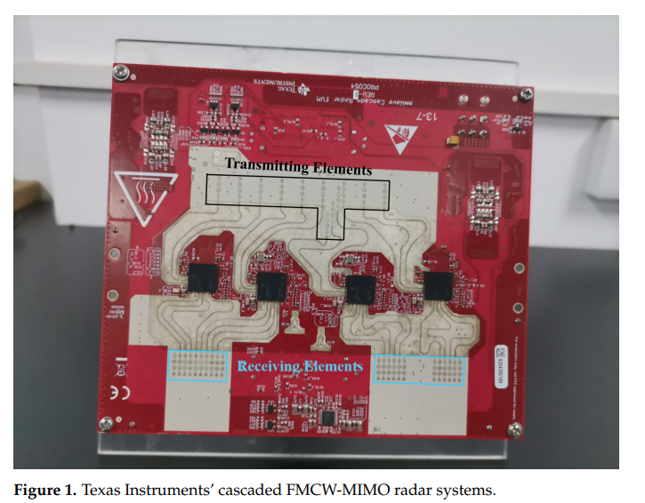
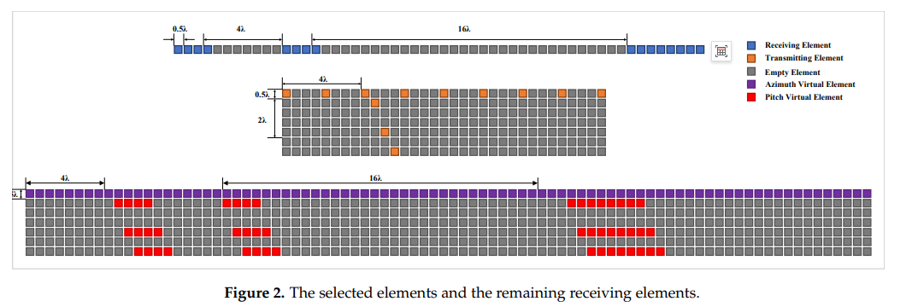
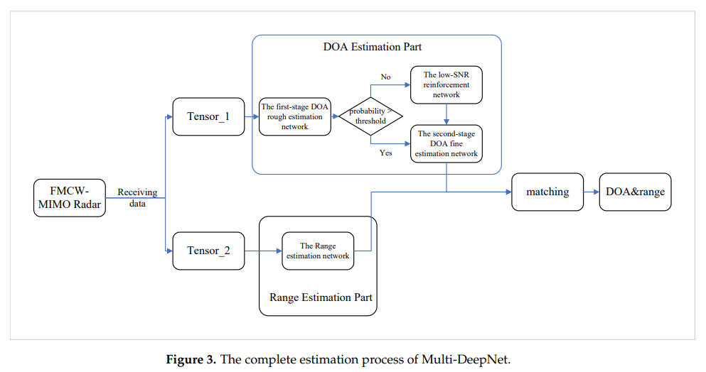
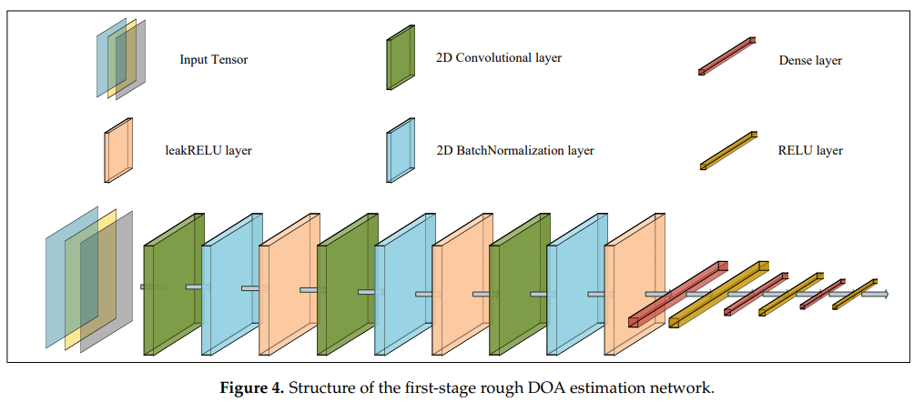
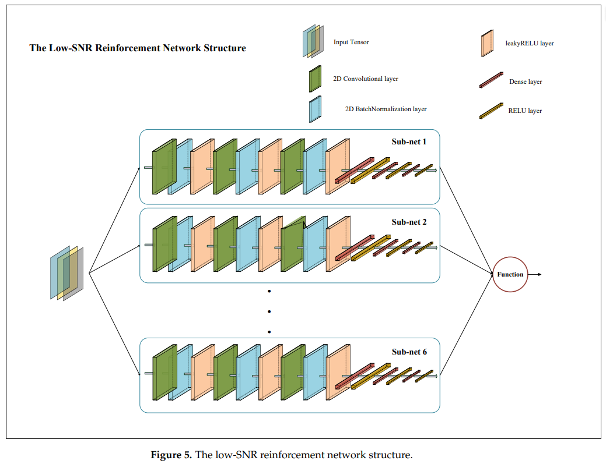
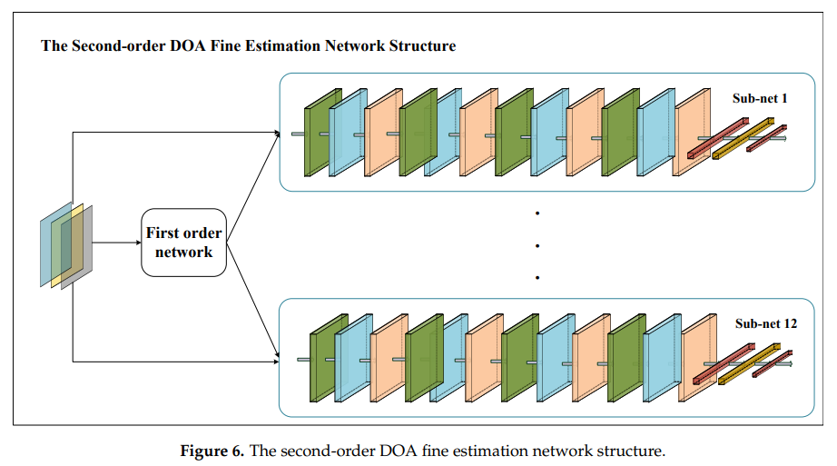
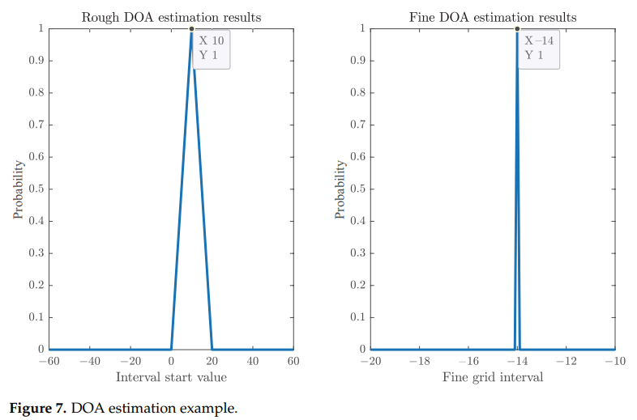
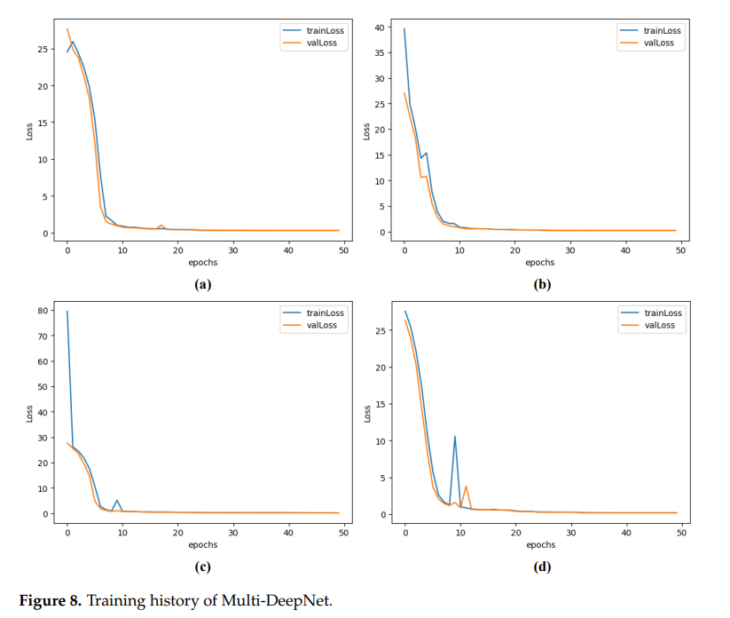
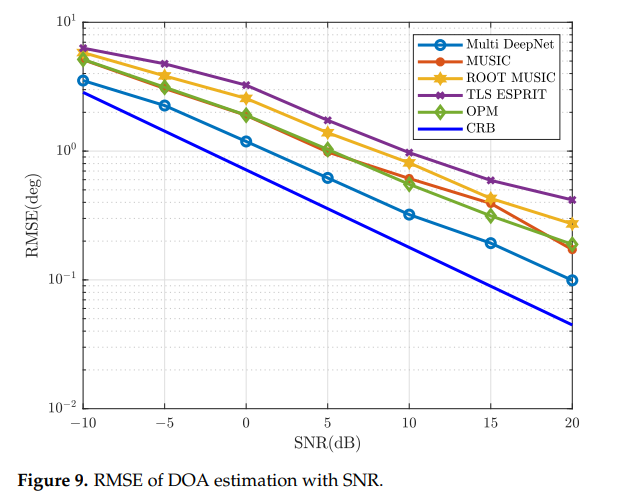
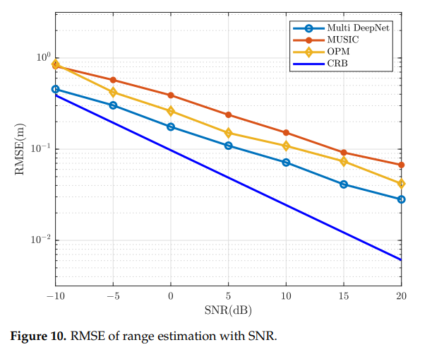
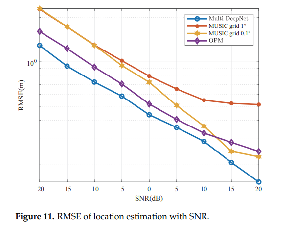
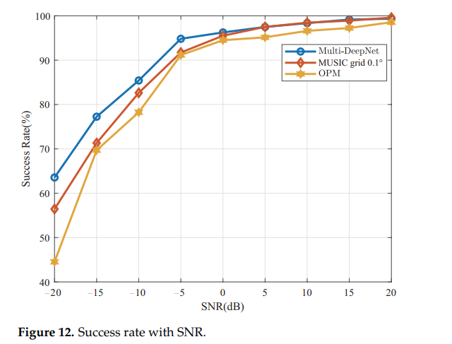
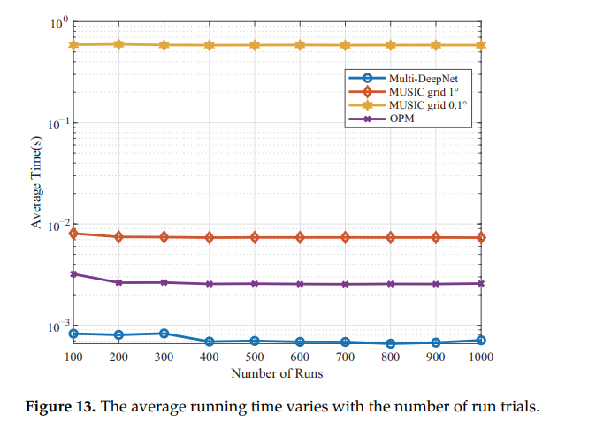
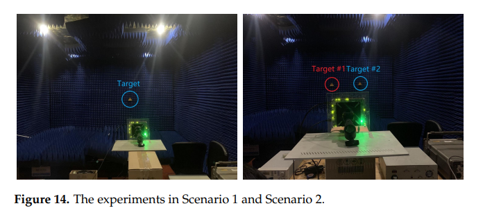
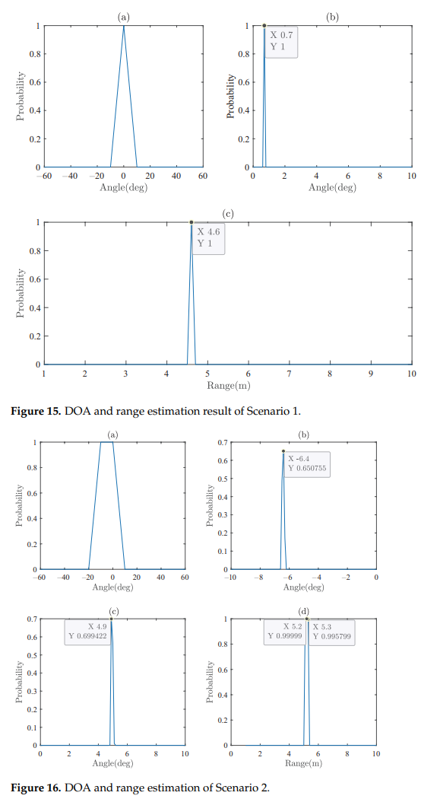
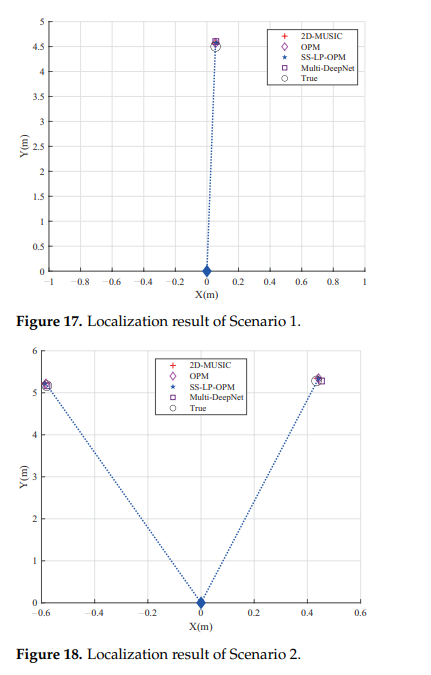

<!-- PAYMENT_BLOCK -->

## Get this dataset

- Payment link (Stripe): [Buy now](https://buy.stripe.com/3cs8yP7sY87d0vu9AB)
- Payment QR code: 

<!-- /PAYMENT_BLOCK -->
